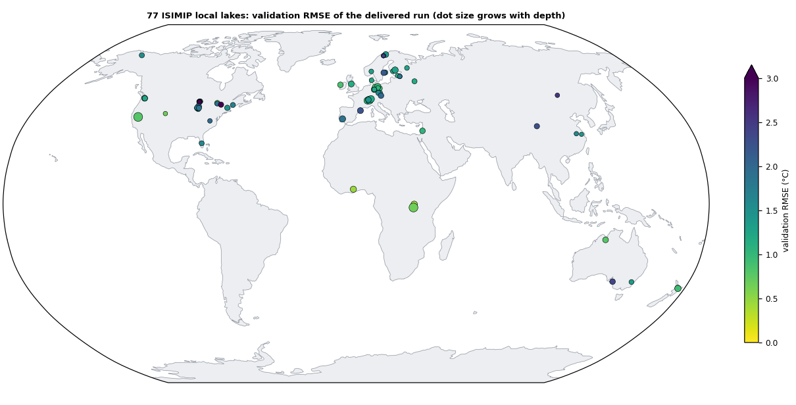
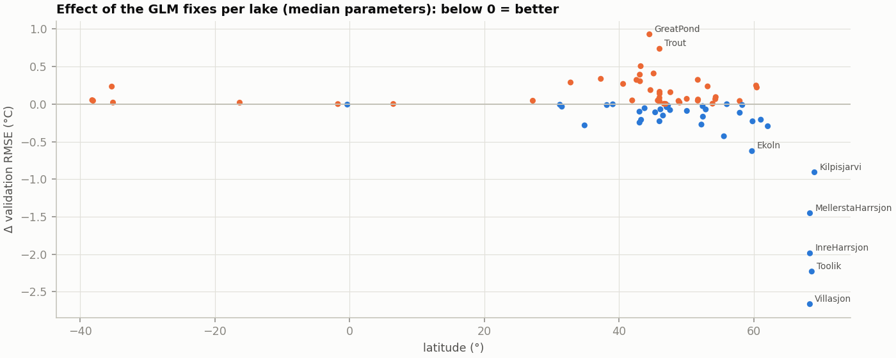
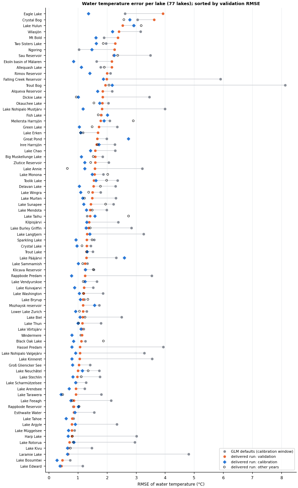
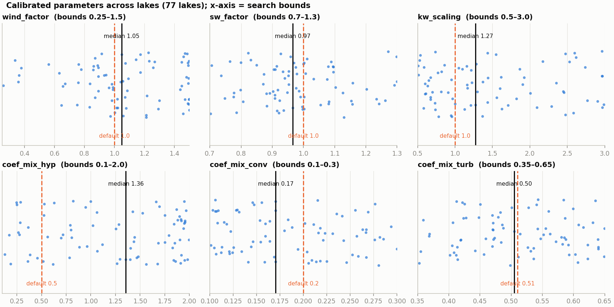
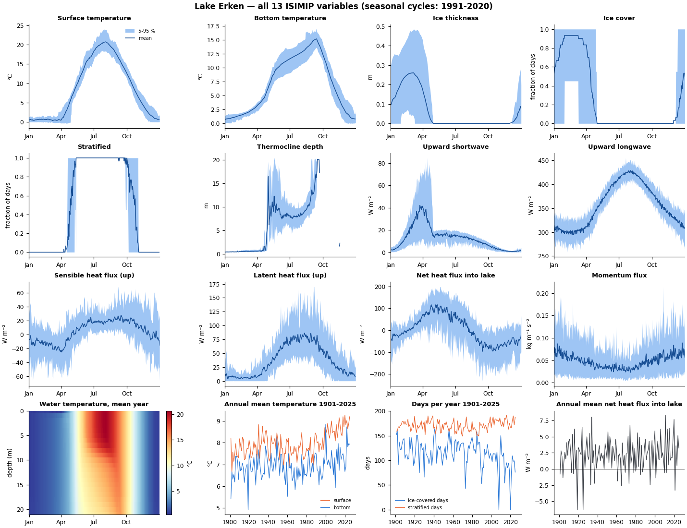
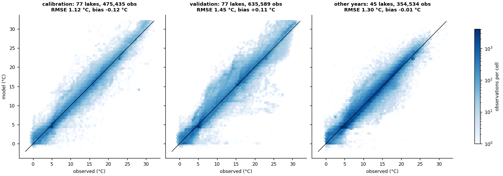
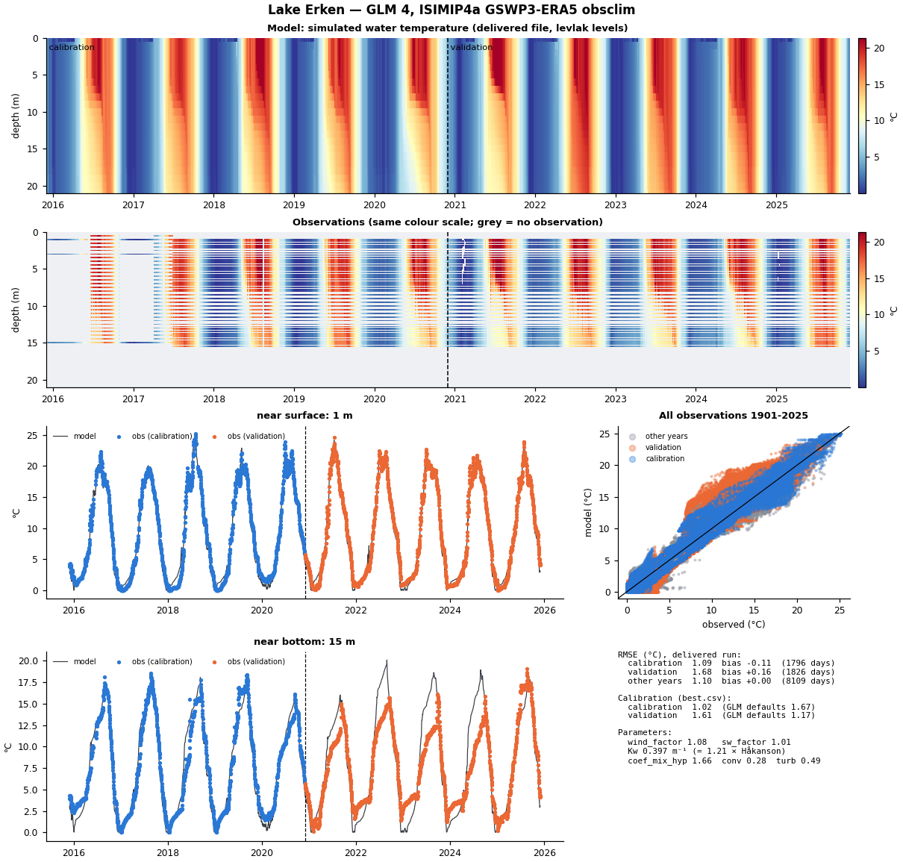

# GLM 4 simulations of the ISIMIP4a local lakes

Daily hydrodynamic simulations of **77 lakes** for the ISIMIP4a lake sector (`lakes_local`), with the
General Lake Model (GLM) 4.0.0, each lake calibrated against its own observed water-temperature
profiles. This repository contains everything needed to reproduce the files submitted to ISIMIP:
the model source pin and our bug fixes, the forcing extraction, the lake setups, the calibration
(code, settings and results), the scripts that write the ISIMIP NetCDF files, and figures that
compare every delivered lake with its observations.

| | |
|---|---|
| Model name in ISIMIP | `glm4` |
| Simulation round / sector | ISIMIP4a / lakes_local |
| Experiment | `gswp3-era5_obsclim_histsoc_default`, 1901-01-01 to 2025-12-31, daily |
| Lakes | 77 (`local_lakes/lake_sites.csv`) |
| Variables | 13: watertemp, surftemp, bottemp, ice, icethick, strat, thermodepth, sensheatf, latentheatf, swup, lwup, lakeheatf, momf |
| Author / contact | Daniel Mercado-Bettín, daniel.mercado@csic.es |
| Institutions | Spanish National Research Council (CSIC), Centre for Advanced Studies of Blanes (CEAB), Spain; Vrije Universiteit Brussel (VUB), Belgium |

<!-- BEGIN:summary -->
Results at a glance: 77 of 77 lakes delivered. Median water-temperature RMSE of the delivered files: **1.11 °C** in the calibration years, **1.30 °C** in the validation years and **1.43 °C** in years the calibration never used (45 lakes); GLM with its default parameters: 1.97 °C in the validation years.
<!-- END:summary -->



## Contents

1. [Model: GLM 4.0.0 and the fixes we applied](#1-model-glm-400-and-the-fixes-we-applied)
2. [Lakes and observations](#2-lakes-and-observations)
3. [Forcing](#3-forcing)
4. [Lake setup](#4-lake-setup)
5. [Calibration](#5-calibration)
6. [ISIMIP4a simulations and output files](#6-isimip4a-simulations-and-output-files)
7. [Evaluation of the delivered files](#7-evaluation-of-the-delivered-files)
8. [Reproducing the simulations](#8-reproducing-the-simulations)
9. [Repository layout](#9-repository-layout)
10. [Acknowledgements, licence, citation](#10-acknowledgements-licence-citation)

## 1. Model: GLM 4.0.0 and the fixes we applied

GLM is a one-dimensional hydrodynamic lake model (Hipsey et al. 2019, GMD 12, 473-523) with a
Lagrangian layer structure. We use **GLM 4.0.0** from
[AquaticEcoDynamics/glm-aed](https://github.com/AquaticEcoDynamics/glm-aed), pinned at commit
`83e20ed` (2026-09-08) with the submodule commits it pins (`get_upstream.sh`). GLM 4.0.0 is a
pre-release (not tagged), so the pin matters. Only the physics is used here (no water-quality
model).

While setting up the simulations we found bugs in GLM that change the physics of every lake.
They are fixed by small patches (`patches/`), applied by `build_glm4.sh` to the pinned source before
compiling. Each was checked against the current upstream `main` and is reported to the developers;
the fork branches show the same fixes as single commits on upstream `main`.

| Patch | What was wrong | Effect | Fork branch |
|---|---|---|---|
| `GLM_daily_shortwave.patch` | With daily forcing (`subdaily = .false.`) GLM spreads the day's shortwave over the day as a half-sine. (1) The solar declination had the wrong sign, so northern lakes got winter day lengths in summer (polar night in June at 74°N); (2) the `acos` argument was not clamped, so polar day/night gave NaN and no sunlight; (3) the half-sine was centred on midnight instead of solar noon. | All lakes here (daily forcing); largest at high latitude. Together with the ice fix: lakes > 66°N, validation RMSE 4.36 → 2.37 °C with the same parameters. Hourly forcing is not affected. | [GLM `fix-daily-shortwave`](https://github.com/danielmerbet/GLM/tree/fix-daily-shortwave) |
| `GLM_ice_turbulent_wind.patch` | Over ice, the sensible (and, while melting, latent) heat flux used the near-zero wind meant for under-ice mixing (`WindSp = 0.0001`), against the code's own comment. | Ice-covered lakes: almost no turbulent heat exchange over ice; high-Arctic lakes never melted out. | [GLM `fix-ice-turbulent-wind`](https://github.com/danielmerbet/GLM/tree/fix-ice-turbulent-wind) |
| `GLM_aed_light_below_ice.patch` | Water-quality coupling only: AED's surface light was the raw forcing shortwave (no albedo, ice or snow). | None here (no AED in these runs). | [GLM `fix-aed-light-below-ice`](https://github.com/danielmerbet/GLM/tree/fix-aed-light-below-ice) |
| `libaed-api_private_extc.patch` | Water-quality coupling only: `bioshade_feedback = .false.` did not stop AED from changing GLM's light extinction. | None here. | [libaed-api `fix-bioshade-feedback-private-extc`](https://github.com/danielmerbet/libaed-api/tree/fix-bioshade-feedback-private-extc) |



*Validation RMSE with the fixed minus the unfixed GLM, same (pre-fix median) parameters for every lake: below 0 = better. The fixes help the high-latitude lakes most; lakes that got worse had parameters tuned to the unfixed model, hence the recalibration (`calibration/RECALIBRATION.md`).*

Build: gfortran/gcc 13.3.0 and netCDF 4.9.2, `--no-gui` (`build_glm4.sh`). On the VUB Hydra cluster
(GCC/13.3.0, netCDF/4.9.2-gompi-2024a modules) `make_glm_launcher.sh` writes `bin/glm-run`, which
pins the build's library directories. The same Erken run gives the same RMSE to all printed digits
on a laptop (Ubuntu 24.04) and on Hydra (Rocky Linux 9).

## 2. Lakes and observations

The 77 lakes are the 73 ISIMIP3 local lakes plus the lakes new in ISIMIP4 (Edward,
Grossglienickersee, Inre Harrsjön, Mellersta Harrsjön, Villasjön), minus "Zurich" (a byte-identical
duplicate of Lower Lake Zurich). They range from 2 m (Crystal Bog) to 501 m (Tahoe) deep, and from
the tropics (Bosumtwi, Edward, Kivu, Argyle) to the Arctic (Kilpisjärvi, Hassel, …).

Observations: water-temperature profiles and hypsographs from the ISIMIP local-lake database
(ISIMIP3) and the ISIMIP4 local-lake delivery, harmonised by `calibration/build_lake_table.py`
(QC: values outside physical limits removed; Bosumtwi: 10 values with the depth entered as
temperature removed). Metadata per lake: `calibration/lakes.csv`. **The observations themselves are
not redistributed here**; they are available from ISIMIP (https://www.isimip.org).

Coordinates: the ISIMIP4 protocol `lake_site` list (`local_lakes/reference/`). The protocol entry of
Bosumtwi has a longitude sign error (+1.25 instead of −1.41); the files use the correct coordinates.

## 3. Forcing

ISIMIP4a **GSWP3-ERA5 obsclim**, daily, 1901-2025, at the nearest 0.5° cell to each lake
(no lake needed a fallback cell). Extracted on DKRZ Levante by `forcing/extract_points_levante.py`
(details and a check against ISIMIP3a GSWP3-W5E5 in `forcing/README.md`). The forcing is not
redistributed here; it is available from the ISIMIP repository.

GLM's meteorological input (daily): air temperature, relative humidity, wind speed, shortwave and
longwave radiation, rain and snow. Shortwave is spread over the day by GLM (see the fix above).

## 4. Lake setup

Each lake's GLM configuration (`local_lakes/setups/<Lake>/glm3.nml`, exactly as run) was built as in the
ISIMIP3 GLM-LER runs (aemon-j/ISIMIP3_LER, LakeEnsemblR template), with these choices:

- **Morphometry**: the observed hypsograph of every lake (Bosumtwi's ISIMIP4 file has its depth axis
  inverted and is flipped).
- **Light extinction**: `Kw` = Håkanson (1995) `1.1925 · zmax^-0.424`, times a calibrated scaling
  (the only rule that also exists for lakes without Secchi data).
- **Closed lake with constant level**: GLM has no fixed-level option, so an inflow of
  1.25 × the estimated evaporation (Dalton bulk formula, GLM's own transfer coefficient) is added at
  the estimated surface temperature; everything above the crest spills
  (`calibration/patch_glm_closed.py`, `calibration/closed_lake_patches.py`). Without it, closed lakes
  drain by evaporation (Allequash 8 → 6.4 m in 10 years).
- **Atmospheric stability correction** (`atm_stab = 1`) for tropical lakes (|lat| ≤ 23.44°) and lakes
  above 1500 m (Argyle, Bosumtwi, Edward, Kivu, Laramie, Ngoring, Tahoe); neutral transfer
  coefficients elsewhere. With neutral coefficients, lakes much warmer than the air lose too little
  heat (Edward: validation RMSE 4.81 → 1.16 °C with the uncalibrated parameters).
- Layers 0.15-1 m thick (Lagrangian), hourly time step, `cd = ce = ch = 0.0013`.

## 5. Calibration

Six parameters per lake, the same set and ranges as the ISIMIP3 GLM-LER calibration (except a wider
light-extinction range):

| Parameter | Range | GLM default | Meaning |
|---|---|---|---|
| `wind_factor` | 0.25-1.5 | 1 | scaling of the forcing wind speed |
| `sw_factor` | 0.7-1.3 | 1 | scaling of the forcing shortwave radiation |
| `kw_scaling` | 0.5-3 | 1 | scaling of the Håkanson light extinction (`Kw` in the setup = Håkanson × scaling) |
| `coef_mix_hyp` | 0.1-2 | 0.5 | hypolimnetic mixing efficiency |
| `coef_mix_conv` | 0.1-0.3 | 0.2 | convective mixing efficiency |
| `coef_mix_turb` | 0.35-0.65 | 0.51 | shear (turbulent) mixing efficiency |

- **Window**: the last ≤ 10 years with observations (ending at the last observation or 2025);
  first half for calibration, second half for validation (`calibration/windows.csv`). 20 years of
  real forcing before the window as spin-up; initial profile from the observed climatology.
- **Objective**: RMSE of water temperature at all observed depths and days of the calibration half
  (model interpolated to the observed depths).
- **Optimiser**: differential evolution (R `DEoptim`), population 60, strategy 2, at most 100
  generations, stopped when the best RMSE improves < 0.1 % over 20 generations, seed 20261021;
  16 cores per lake on Hydra (`calibration/hydra_calibrate.slurm`).
- **Results** per lake: `calibration/results/<Lake>/best.csv` (parameters, RMSE calibrated and with
  GLM defaults, generations, runtime) and `trace.csv` (convergence); all lakes in
  `calibration/results_all.csv`.

<!-- BEGIN:calibration -->
Over the 77 calibrated lakes (median, interquartile range in brackets): calibration RMSE **1.02 °C** (0.84-1.28), validation **1.37 °C** (1.06-1.69); with GLM's default parameters 1.94 and 1.97 °C. The calibration improved the validation RMSE in 66 of 77 lakes. Calibrated parameter medians: `wind_factor` 1.05, `sw_factor` 0.965, `kw_scaling` 1.27, `coef_mix_hyp` 1.36, `coef_mix_conv` 0.17, `coef_mix_turb` 0.505; 20 lakes have at least one parameter at a bound (`at_bound` in `results_all.csv`).
<!-- END:calibration -->





## 6. ISIMIP4a simulations and output files

Per lake (`local_lakes/setup_run.py`, run by `local_lakes/hydra_local_lakes.slurm`):

- the lake's calibrated parameters;
- **spin-up**: the forcing of 1901-1920 repeated in front of 1901 (dated 1881-1900; 29 Feb 1920,
  which has no 1900 counterpart, is dropped), so the run starts 1881-01-01. ISIMIP's `spinclim`
  forcing is not used;
- run to 2026-01-01 (one padding day so that 2025-12-31 is complete), daily output.

`local_lakes/write_isimip.py` writes one NetCDF file per variable and lake, ISIMIP naming:

```
glm4_gswp3-era5_obsclim_histsoc_default_<variable>_<lake-site>_daily_1901_2025.nc
```

| Variable | Units | Definition in these files |
|---|---|---|
| `watertemp` | K | water temperature on fixed levels: every 1 m from the surface (0.5 m for lakes < 10 m deep) to the bottom; each value is the exact volume-weighted average of GLM's layers between the level bounds (`levlak_bnds`) |
| `surftemp` | K | temperature of GLM's top layer |
| `bottemp` | K | temperature of GLM's bottom layer |
| `ice` | 1 | 1 if there is ice (blue + white), else 0 |
| `icethick` | m | blue + white ice thickness (snow not included) |
| `strat` | 1 | 1 if ρ(bottom) − ρ(surface) ≥ 0.005 kg m⁻³ **and** T(surface) > T(bottom), else 0: the ISIMIP4T density threshold, counting only direct (summer) stratification; inverse stratification under ice is not counted (Chen density, GLM top and bottom layer) |
| `thermodepth` | m | depth of the maximum density gradient (Python port of rLakeAnalyzer `thermo.depth`, non-seasonal) on GLM's full profile; missing when there is no thermocline |
| `sensheatf`, `latentheatf` | W m⁻² | GLM's daily mean sensible and latent heat fluxes, positive upwards |
| `swup` | W m⁻² | forcing shortwave × `sw_factor` − GLM's daily mean net shortwave |
| `lwup` | W m⁻² | forcing longwave − GLM's daily mean net longwave |
| `lakeheatf` | W m⁻² | swdown − swup + lwdown − lwup − sensheatf − latentheatf (net heat flux into the lake) |
| `momf` | kg m⁻¹ s⁻² | ρ_air · C_D · U², U = daily mean wind × `wind_factor` |

Details: GLM stamps each daily output with the end of its day, so the value stamped day D is
assigned to day D − 1 (checked against the forcing: daily shortwave correlates 0.991 with the
previous day, 0.888 with the stamp's day). Time axis: days since 1901-01-01, proleptic Gregorian;
missing value 1e20; compressed (zlib). Each lake folder also has `SHA256SUMS` and the namelist used.

<!-- BEGIN:lakeheatf -->
**Note on `lakeheatf`.** Averaged over 1901-2025, the net surface heat flux is not zero in every lake although the lakes do not warm at that rate: median +3.6 W m⁻², from -29 (Ngoring) to +36 W m⁻² (MtBold); warm reservoirs are positive, cold ice-covered lakes negative. The flux is computed exactly as defined (surface fluxes of GLM, positive into the lake); the difference must leave the lake by other routes in GLM (e.g. the evaporation-compensating inflow and the overflow, or energy taken up by the ice). This is being investigated; use `lakeheatf` with care for long-term energy budgets.
<!-- END:lakeheatf -->

**Known limitations.**
- *Deep water of the deepest lakes.* In Thun (212 m), Neuchâtel (152 m) and Tahoe (501 m) GLM rarely mixes the
  lake to the bottom, so the deep water keeps nearly the temperature it starts with: `bottemp` changes by less than
  0.5 °C over 1901-2025 (Thun 0.03 °C), and in Tahoe it stays at 4.5 °C while the observed water at 437 m is
  5.0-5.3 °C and warming. The upper water is calibrated (Tahoe validation RMSE 0.8 °C); do not use `bottemp` or deep
  `watertemp` of these lakes for trends. (Kivu, Bosumtwi and Edward are permanently stratified in reality too.)
- *Ice on Tahoe.* The model forms ice in two cold winters (about 20 days around 1917 and 58 days around 1949);
  Lake Tahoe does not freeze.
- *Trout Lake hypsometry (corrected).* The ISIMIP3 hypsometry of Trout Lake gave 160.8 km² at the surface, ten
  times the lake (16.08 km², NTL-LTER); all its areas were divided by 10 (`calibration/build_lake_table.py`) and the lake
  was re-calibrated and re-run. Validation RMSE of the calibration 1.51 → 1.41 °C, of the delivered file 1.56 → 1.29 °C
  (GLM defaults 2.46 → 1.51 °C). Found when the observations were reviewed for
  [ISIMIP4_Local_Lakes_ObsData](https://github.com/ISIMIP-LAKE/ISIMIP4_Local_Lakes_ObsData).



## 7. Evaluation of the delivered files

`local_lakes/plot_local_lakes.py` compares the **delivered files** (not the calibration runs) with
every observation of each lake in 1901-2025, in three groups: the calibration half, the validation
half, and all other years (observations the calibration never saw). Scores per lake:
`results/scores.csv`. Figures per lake: `figures/lakes/<Lake>_temperature.png` and
`figures/lakes/<Lake>_variables.png` ([list below](#figures-per-lake)).

<!-- BEGIN:evaluation -->
Median RMSE (°C) of the delivered files per lake, and the bias (model − observation):

| Observations | Lakes | Median RMSE | Median bias |
|---|---|---|---|
| calibration half | 77 | 1.11 | -0.05 |
| validation half | 77 | 1.30 | +0.01 |
| all other years 1901-2025 | 45 | 1.43 | -0.02 |

The delivered run differs from the calibration runs (125 years with a repeated-forcing spin-up instead of a 20-year spin-up and an observed initial profile), so its calibration/validation scores differ slightly from `best.csv`.

File checks (`local_lakes/qc_isimip.py`, `results/qc.csv`): every lake has the 13 files, 45,656 days, the required attributes and matching checksums; all values in plausible ranges and finite, except `thermodepth` on days without a thermocline. `watertemp` has missing values only for levels below the lake bottom on days when the water level is below the spill level (ice, evaporation): median 0.1 % of days, at most 3 levels.
<!-- END:evaluation -->





### Figures per lake

<!-- BEGIN:lake_table -->
| Lake | Depth (m) | RMSE cal / val / other (°C) | Figures |
|---|---|---|---|
| Allequash Lake | 7 | 1.12 / 2.17 / 1.91 | [temperature](figures/lakes/Allequash_temperature.png), [all variables](figures/lakes/Allequash_variables.png) |
| Alqueva Reservoir | 72 | 1.68 / 1.85 / – | [temperature](figures/lakes/Alqueva_temperature.png), [all variables](figures/lakes/Alqueva_variables.png) |
| Lake Annie | 19 | 1.24 / 1.58 / 0.64 | [temperature](figures/lakes/Annie_temperature.png), [all variables](figures/lakes/Annie_variables.png) |
| Lake Arendsee | 49 | 0.69 / 0.93 / – | [temperature](figures/lakes/Arendsee_temperature.png), [all variables](figures/lakes/Arendsee_variables.png) |
| Lake Argyle | 44 | 0.91 / 0.79 / – | [temperature](figures/lakes/Argyle_temperature.png), [all variables](figures/lakes/Argyle_variables.png) |
| Lake Biel | 74 | 1.07 / 1.17 / 1.25 | [temperature](figures/lakes/Biel_temperature.png), [all variables](figures/lakes/Biel_variables.png) |
| Big Muskellunge Lake | 21 | 1.12 / 1.60 / 1.53 | [temperature](figures/lakes/BigMuskellunge_temperature.png), [all variables](figures/lakes/BigMuskellunge_variables.png) |
| Black Oak Lake | 26 | 0.85 / 1.12 / 1.88 | [temperature](figures/lakes/BlackOak_temperature.png), [all variables](figures/lakes/BlackOak_variables.png) |
| Lake Bosumtwi | 73.4 | 0.28 / 0.47 / – | [temperature](figures/lakes/Bosumtwi_temperature.png), [all variables](figures/lakes/Bosumtwi_variables.png) |
| Lake Bryrup | 9 | 1.08 / 1.18 / 1.34 | [temperature](figures/lakes/Bryrup_temperature.png), [all variables](figures/lakes/Bryrup_variables.png) |
| Lake Burley Griffin | 17 | 1.28 / 1.36 / 1.43 | [temperature](figures/lakes/BurleyGriffin_temperature.png), [all variables](figures/lakes/BurleyGriffin_variables.png) |
| Lake Chao | 7.98 | 1.43 / 1.60 / – | [temperature](figures/lakes/Chao_temperature.png), [all variables](figures/lakes/Chao_variables.png) |
| Crystal Lake | 22 | 0.96 / 1.30 / 1.14 | [temperature](figures/lakes/Crystal_temperature.png), [all variables](figures/lakes/Crystal_variables.png) |
| Crystal Bog | 2 | 2.78 / 3.63 / 2.58 | [temperature](figures/lakes/CrystalBog_temperature.png), [all variables](figures/lakes/CrystalBog_variables.png) |
| Delavan Lake | 16.46 | 1.05 / 1.54 / 1.78 | [temperature](figures/lakes/Delavan_temperature.png), [all variables](figures/lakes/Delavan_variables.png) |
| Dickie Lake | 12 | 1.01 / 1.85 / 0.95 | [temperature](figures/lakes/Dickie_temperature.png), [all variables](figures/lakes/Dickie_variables.png) |
| Eagle Lake | 35 | 1.36 / 3.93 / – | [temperature](figures/lakes/Eagle_temperature.png), [all variables](figures/lakes/Eagle_variables.png) |
| Lake Edward | 116 | 0.38 / 0.44 / – | [temperature](figures/lakes/Edward_temperature.png), [all variables](figures/lakes/Edward_variables.png) |
| Ekoln basin of Mälaren | 37.06 | 0.84 / 2.17 / – | [temperature](figures/lakes/Ekoln_temperature.png), [all variables](figures/lakes/Ekoln_variables.png) |
| Lake Erken | 21 | 1.09 / 1.68 / 1.10 | [temperature](figures/lakes/Erken_temperature.png), [all variables](figures/lakes/Erken_variables.png) |
| Esthwaite Water | 16 | 0.90 / 0.86 / – | [temperature](figures/lakes/EsthwaiteWater_temperature.png), [all variables](figures/lakes/EsthwaiteWater_variables.png) |
| Falling Creek Reservoir | 9.3 | 1.88 / 1.99 / – | [temperature](figures/lakes/FallingCreek_temperature.png), [all variables](figures/lakes/FallingCreek_variables.png) |
| Lake Feeagh | 46.81 | 0.76 / 0.86 / 0.81 | [temperature](figures/lakes/Feeagh_temperature.png), [all variables](figures/lakes/Feeagh_variables.png) |
| Fish Lake | 19 | 2.01 / 1.79 / 1.70 | [temperature](figures/lakes/Fish_temperature.png), [all variables](figures/lakes/Fish_variables.png) |
| Great Pond | 21 | 2.74 / 1.67 / – | [temperature](figures/lakes/GreatPond_temperature.png), [all variables](figures/lakes/GreatPond_variables.png) |
| Green Lake | 73 | 1.05 / 1.72 / 1.49 | [temperature](figures/lakes/Green_temperature.png), [all variables](figures/lakes/Green_variables.png) |
| Groß Glienicker See | 11.25 | 0.81 / 1.03 / – | [temperature](figures/lakes/Grossglienickersee_temperature.png), [all variables](figures/lakes/Grossglienickersee_variables.png) |
| Harp Lake | 37.5 | 0.66 / 0.79 / 0.81 | [temperature](figures/lakes/Harp_temperature.png), [all variables](figures/lakes/Harp_variables.png) |
| Hassel Predam | 14 | 0.79 / 1.07 / – | [temperature](figures/lakes/Hassel_temperature.png), [all variables](figures/lakes/Hassel_variables.png) |
| Lake Hulun | 7.53 | 2.92 / 2.54 / 3.18 | [temperature](figures/lakes/Hulun_temperature.png), [all variables](figures/lakes/Hulun_variables.png) |
| Inre Harrsjön | 5.2 | 1.73 / 1.64 / 1.68 | [temperature](figures/lakes/InreHarrsjon_temperature.png), [all variables](figures/lakes/InreHarrsjon_variables.png) |
| Kilpisjärvi | 44 | 1.30 / 1.39 / – | [temperature](figures/lakes/Kilpisjarvi_temperature.png), [all variables](figures/lakes/Kilpisjarvi_variables.png) |
| Lake Kinneret | 42 | 0.79 / 1.05 / – | [temperature](figures/lakes/Kinneret_temperature.png), [all variables](figures/lakes/Kinneret_variables.png) |
| Lake Kivu | 483 | 0.64 / 0.66 / 0.74 | [temperature](figures/lakes/Kivu_temperature.png), [all variables](figures/lakes/Kivu_variables.png) |
| Klicava Reservoir | 37 | 1.25 / 1.25 / 1.53 | [temperature](figures/lakes/Klicava_temperature.png), [all variables](figures/lakes/Klicava_variables.png) |
| Lake Kuivajarvi | 10 | 0.88 / 1.21 / – | [temperature](figures/lakes/Kuivajarvi_temperature.png), [all variables](figures/lakes/Kuivajarvi_variables.png) |
| Lake Langtjern | 9 | 1.40 / 1.31 / – | [temperature](figures/lakes/Langtjern_temperature.png), [all variables](figures/lakes/Langtjern_variables.png) |
| Laramie Lake | 6.4 | 0.64 / 0.66 / – | [temperature](figures/lakes/Laramie_temperature.png), [all variables](figures/lakes/Laramie_variables.png) |
| Lower Lake Zurich | 136 | 0.92 / 1.17 / 1.06 | [temperature](figures/lakes/LowerLakeZurich_temperature.png), [all variables](figures/lakes/LowerLakeZurich_variables.png) |
| Mellersta Harrsjön | 6.7 | 1.90 / 1.78 / 2.91 | [temperature](figures/lakes/MellerstaHarrsjon_temperature.png), [all variables](figures/lakes/MellerstaHarrsjon_variables.png) |
| Lake Mendota | 25 | 1.30 / 1.42 / 1.49 | [temperature](figures/lakes/Mendota_temperature.png), [all variables](figures/lakes/Mendota_variables.png) |
| Lake Monona | 21.34 | 1.49 / 1.58 / 2.03 | [temperature](figures/lakes/Monona_temperature.png), [all variables](figures/lakes/Monona_variables.png) |
| Mozhaysk reservoir | 21 | 1.57 / 1.18 / – | [temperature](figures/lakes/Mozhaysk_temperature.png), [all variables](figures/lakes/Mozhaysk_variables.png) |
| Mt Bold | 44.5 | 1.62 / 2.38 / – | [temperature](figures/lakes/MtBold_temperature.png), [all variables](figures/lakes/MtBold_variables.png) |
| Lake Müggelsee | 8.92 | 0.67 / 0.79 / – | [temperature](figures/lakes/Muggelsee_temperature.png), [all variables](figures/lakes/Muggelsee_variables.png) |
| Lake Murten | 45 | 1.16 / 1.49 / 1.23 | [temperature](figures/lakes/Murten_temperature.png), [all variables](figures/lakes/Murten_variables.png) |
| Lake Neuchâtel | 154 | 1.15 / 1.00 / 1.35 | [temperature](figures/lakes/Neuchatel_temperature.png), [all variables](figures/lakes/Neuchatel_variables.png) |
| Ngoring | 30.7 | 1.47 / 2.26 / – | [temperature](figures/lakes/Ngoring_temperature.png), [all variables](figures/lakes/Ngoring_variables.png) |
| Lake Nohipalo Mustjärv | 8.9 | 1.17 / 1.82 / – | [temperature](figures/lakes/NohipaloMustjarv_temperature.png), [all variables](figures/lakes/NohipaloMustjarv_variables.png) |
| Lake Nohipalo Valgejärv | 12.5 | 0.91 / 1.07 / – | [temperature](figures/lakes/NohipaloValgejarv_temperature.png), [all variables](figures/lakes/NohipaloValgejarv_variables.png) |
| Okauchee Lake | 28 | 1.74 / 1.84 / 1.55 | [temperature](figures/lakes/Okauchee_temperature.png), [all variables](figures/lakes/Okauchee_variables.png) |
| Lake Pääjärvi | 80 | 2.60 / 1.29 / – | [temperature](figures/lakes/Paajarvi_temperature.png), [all variables](figures/lakes/Paajarvi_variables.png) |
| Rappbode Reservoir | 85.6 | 1.02 / 0.86 / 1.04 | [temperature](figures/lakes/Rappbode_temperature.png), [all variables](figures/lakes/Rappbode_variables.png) |
| Rappbode Predam | 17 | 0.78 / 1.24 / – | [temperature](figures/lakes/Rappbodep_temperature.png), [all variables](figures/lakes/Rappbodep_variables.png) |
| Rimov Reservoir | 44.48 | 1.41 / 2.00 / – | [temperature](figures/lakes/Rimov_temperature.png), [all variables](figures/lakes/Rimov_variables.png) |
| Lake Rotorua | 53 | 0.86 / 0.70 / 0.84 | [temperature](figures/lakes/Rotorua_temperature.png), [all variables](figures/lakes/Rotorua_variables.png) |
| Lake Sammamish | 31 | 1.02 / 1.25 / 1.17 | [temperature](figures/lakes/Sammamish_temperature.png), [all variables](figures/lakes/Sammamish_variables.png) |
| Sau Reservoir | 59.54 | 2.25 / 2.23 / 2.37 | [temperature](figures/lakes/Sau_temperature.png), [all variables](figures/lakes/Sau_variables.png) |
| Lake Scharmützelsee | 32 | 0.92 / 0.94 / – | [temperature](figures/lakes/Scharmutzel_temperature.png), [all variables](figures/lakes/Scharmutzel_variables.png) |
| Sparkling Lake | 19 | 0.93 / 1.30 / 1.49 | [temperature](figures/lakes/Sparkling_temperature.png), [all variables](figures/lakes/Sparkling_variables.png) |
| Lake Stechlin | 70 | 0.82 / 0.97 / 1.12 | [temperature](figures/lakes/Stechlin_temperature.png), [all variables](figures/lakes/Stechlin_variables.png) |
| Lake Sunapee | 34.5 | 1.20 / 1.45 / 1.95 | [temperature](figures/lakes/Sunapee_temperature.png), [all variables](figures/lakes/Sunapee_variables.png) |
| Lake Tahoe | 502.4 | 0.59 / 0.80 / – | [temperature](figures/lakes/Tahoe_temperature.png), [all variables](figures/lakes/Tahoe_variables.png) |
| Lake Taihu | 13.31 | 1.59 / 1.42 / 2.74 | [temperature](figures/lakes/Taihu_temperature.png), [all variables](figures/lakes/Taihu_variables.png) |
| Lake Tarawera | 87.5 | 0.42 / 0.93 / 0.48 | [temperature](figures/lakes/Tarawera_temperature.png), [all variables](figures/lakes/Tarawera_variables.png) |
| Lake Thun | 212 | 1.00 / 1.15 / 1.03 | [temperature](figures/lakes/Thun_temperature.png), [all variables](figures/lakes/Thun_variables.png) |
| Toolik Lake | 26 | 1.62 / 1.54 / 1.99 | [temperature](figures/lakes/Toolik_temperature.png), [all variables](figures/lakes/Toolik_variables.png) |
| Trout Lake | 33 | 1.32 / 1.29 / 1.31 | [temperature](figures/lakes/Trout_temperature.png), [all variables](figures/lakes/Trout_variables.png) |
| Trout Bog | 8 | 2.18 / 1.94 / 2.07 | [temperature](figures/lakes/TroutBog_temperature.png), [all variables](figures/lakes/TroutBog_variables.png) |
| Two Sisters Lake | 19 | 1.63 / 2.28 / 1.87 | [temperature](figures/lakes/TwoSisters_temperature.png), [all variables](figures/lakes/TwoSisters_variables.png) |
| Lake Vendyurskoe | 14 | 1.24 / 1.23 / 1.18 | [temperature](figures/lakes/Vendyurskoe_temperature.png), [all variables](figures/lakes/Vendyurskoe_variables.png) |
| Villasjön | 1 | 2.19 / 2.41 / – | [temperature](figures/lakes/Villasjon_temperature.png), [all variables](figures/lakes/Villasjon_variables.png) |
| Lake Võrtsjärv | 6.1 | 1.11 / 1.14 / – | [temperature](figures/lakes/Vortsjarv_temperature.png), [all variables](figures/lakes/Vortsjarv_variables.png) |
| Lake Washington | 65.2 | 1.05 / 1.20 / 1.19 | [temperature](figures/lakes/Washington_temperature.png), [all variables](figures/lakes/Washington_variables.png) |
| Windermere | 42 | 0.80 / 1.14 / – | [temperature](figures/lakes/Windermere_temperature.png), [all variables](figures/lakes/Windermere_variables.png) |
| Lake Wingra | 4 | 1.10 / 1.51 / 1.37 | [temperature](figures/lakes/Wingra_temperature.png), [all variables](figures/lakes/Wingra_variables.png) |
| Zlutice Reservoir | 24.8 | 1.24 / 1.60 / 1.44 | [temperature](figures/lakes/Zlutice_temperature.png), [all variables](figures/lakes/Zlutice_variables.png) |
<!-- END:lake_table -->

## 8. Reproducing the simulations

```bash
bash get_upstream.sh            # pinned GLM-AED source -> upstream/
bash build_glm4.sh              # apply patches/, build bin/glm-built
bash make_glm_launcher.sh       # bin/glm-run
```

Then, in order (each script documents its inputs):

1. `calibration/build_lake_table.py`: lake table, harmonised observations, hypsographs (needs the
   ISIMIP local-lake observations and the LakeEnsemblR.WQ harmoniser, see the paths at the top);
2. `forcing/extract_points_levante.py`: forcing at the lake points (on DKRZ Levante);
3. `calibration/setup_lake_glm.R all`, `calibration/patch_glm_closed.py all`: GLM folders;
4. `calibration/hydra_calibrate.slurm`: calibration, one array task per lake;
5. `calibration/collect_results.py`: `results_all.csv`;
6. `local_lakes/hydra_local_lakes.slurm`: setup, 1881-2025 run and NetCDF files per lake;
7. `local_lakes/plot_local_lakes.py`: scores and figures.

Software: Python 3 (numpy, pandas, netCDF4, matplotlib, cartopy), R ≥ 4.3 (data.table, DEoptim,
glmtools, LakeEnsemblR, lubridate, configr).

## 9. Repository layout

```
get_upstream.sh, build_glm4.sh, make_glm_launcher.sh, patches/   GLM source pin, fixes, build
forcing/          forcing extraction (ISIMIP4a GSWP3-ERA5)
calibration/      lake table, setups, calibration code, settings and results (README.md, RECALIBRATION.md)
local_lakes/      ISIMIP4a runs and NetCDF writer, lake sites, namelists as run (setups/)
global_test/      helper modules used by the writer (layer geometry, exact level averages)
analysis/         calibration figures
results/          scores of the delivered files against the observations
figures/          summary and per-lake figures
docs/             notes on the ISIMIP local-lake file format
```

## 10. Acknowledgements, licence, citation

We thank **Wim Thiery** (Vrije Universiteit Brussel) for access to the VUB Hydra HPC system. The
computational resources and services used in this work were provided by the VSC (Flemish
Supercomputer Center), funded by the Research Foundation - Flanders (FWO) and the Flemish Government.
Forcing and lake observations: the ISIMIP project (https://www.isimip.org) and the data providers of
the ISIMIP local lakes. GLM and AED: AquaticEcoDynamics, The University of Western Australia.

Licences: the **code and documentation** in this repository are GPL-3.0 (`LICENSE`), as GLM itself.
The **simulation output** (the ISIMIP4a NetCDF files) is released under **CC0 1.0** (public domain
dedication, https://creativecommons.org/publicdomain/zero/1.0/); each file carries a `license` attribute.

Cite: Mercado-Bettín, D.: GLM 4 simulations of the ISIMIP4a local lakes,
https://github.com/danielmerbet/GLM4-ISIMIP4a-local-lakes (2026), and for the model Hipsey et al.
(2019), https://doi.org/10.5194/gmd-12-473-2019.
